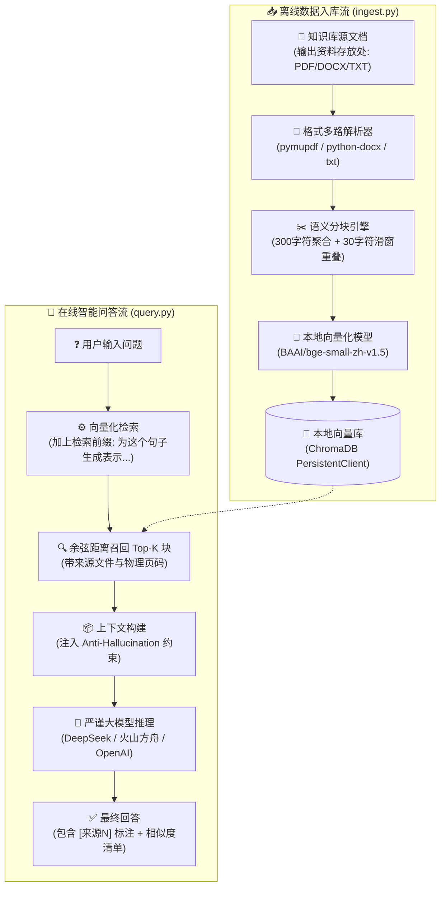

# 个人知识库 RAG Agent (Personal Knowledge Base RAG Agent)

<p align="center">
  
  
  
  
  
</p>

> **轻量、本地优先、严谨溯源、零幻觉的个人私有智能知识库问答系统。**
> 
> 把你散落的课程笔记、芯片数据手册 (Datasheet)、工程文档、PDF 研报转化成可实时对话的知识库。提问后系统**仅依据库内资料回答**，逐句标注 `[来源N]` 引用出处，并在文末附带精确相似度评分。资料未包含的内容坚决直说，杜绝模型幻觉胡编。

---

## 🌟 核心特性

- 🔒 **本地优先与隐私安全**：
  采用本地轻量向量模型 `BAAI/bge-small-zh-v1.5`（~100MB，首次运行自动下载，离线可用），原始文本向量化过程无需调用第三方付费 API，结合内嵌轻量 ChromaDB 数据库，全量数据在本地持久化。
- 🛡️ **严格零幻觉约束 (Anti-Hallucination)**：
  预设严密的防幻觉提示词系统，强制大模型只能基于召回上下文作答；对未入库或无关知识严格声明“资料里没有相关信息”，杜绝模型脑补。
- 📌 **精准引用与相似度溯源**：
  在回答正文末尾标注 `[来源N]` 引用标号，并在回答下方清晰输出各召回切片的来源文件名和余弦相似度分数，每一句话都有据可查。
- 📑 **多格式混合解析**：
  内置多文档解析器，支持 `.pdf`（逐页精准提取并自动注入物理页码 `[第N页]`）、`.docx`（段落语义抽取）与 `.txt`（自动 UTF-8 容错解码）。
- 🔄 **自适应分块与增量去重**：
  按段落自然边界聚合成块（默认 300 字符切片 + 30 字符重叠滑动窗口）；基于 `文件名-分块序号-内容SHA1` 生成确定性哈希 ID，多次入库自动跳过重复块，支持即放即存的增量入库。
- 🔌 **通用大模型热插拔**：
  底层完全基于标准 OpenAI SDK 接口规范，通过修改 `.env` 配置文件即可一秒切换 DeepSeek、火山方舟（豆包 / 自定义推理接入点）、Moonshot、通义千问等主流大模型，无需修改任何代码。
- 🖱️ **Windows 一键极简启动**：
  为 Windows 用户配备 `1_导入文档入库.bat` 和 `2_启动知识库问答.bat`，自动探测 Python 环境与 UTF-8 编码，无需手动输入终端命令。
- 📊 **可视化交互架构与时序图**：
  仓库内附带可视化 HTML 架构全景图（`rag_agent_architecture.html`）与全链路时序图（`rag_query_sequence.html`），直观解析 RAG 处理流程。
- 🧪 **完整 Benchmark 硬件手册评测**：
  内置覆盖 8 份主流芯片电子手册（含 STM32F103、EC600M、TL431、LM2596 等）的 24 道严苛检索基准测试集与 4 道库外泛化拒答题，附带完整复现评测脚本。

---

## 🏗️ 系统架构



---

## 📁 目录结构

```text
.
├── 1_导入文档入库.bat          # [Windows] 一键导入文档入库批处理脚本
├── 2_启动知识库问答.bat          # [Windows] 一键启动智能交互问答批处理脚本
├── fix_bat.py                 # 批处理脚本一键修复/生成辅助工具
├── rag_agent_architecture.html # RAG 系统架构交互式可视化网页
├── rag_query_sequence.html     # RAG 检索问答时序交互式可视化网页
├── 输出资料存放处/              # 默认文档存放目录（支持子文件夹递归读取）
│   ├── EE28变压器绕制笔记.txt
│   ├── PID控制原理.docx
│   ├── SQL主键与索引.pdf
│   └── datasheets/            # 常用电子芯片硬件手册测试集 (STM32/TL431/LM2596等)
├── knowledge-agent/            # 核心业务逻辑源码
│   ├── config.py              # 配置集中解析（读取 .env，路径标准化）
│   ├── ingest.py              # 文档扫描、解析、分块、本地向量化入库
│   ├── query.py               # 命令行问答入口、向量召回、LLM 引用推理
│   ├── requirements.txt       # Python 依赖清单
│   ├── .env.example           # 环境变量配置模板
│   ├── data_test/             # 官方内置演示数据
│   └── evaluation/            # 电子手册基准测试评测套件
│       ├── datasheet_cases.json       # 24 道库内参数题 + 4 道库外题
│       ├── run_datasheet_eval.py      # 基准测试执行脚本
│       └── reports/                   # 评测结果报告 (Markdown/JSON)
├── LICENSE                    # MIT 开源授权协议
└── README.md                  # 项目主说明文档
```

---

## 🚀 快速开始

### 1. 克隆代码仓库

```bash
git clone https://github.com/eggdan6666/personal-knowledge-rag-agent.git
cd personal-knowledge-rag-agent
```

### 2. 安装环境依赖

推荐使用 Python 3.10 或 3.11 环境：

```bash
cd knowledge-agent
pip install -r requirements.txt
```

> **国内镜像加速**：若下载较慢，可使用清华镜像：
> ```bash
> pip install -r requirements.txt -i https://pypi.tuna.tsinghua.edu.cn/simple
> ```

### 3. 配置密钥与环境参数

复制 `knowledge-agent/.env.example` 为 `knowledge-agent/.env`（或在根目录创建 `.env`）：

```bash
# 在 knowledge-agent 目录下执行
copy .env.example .env
```

打开 `.env` 文件，填入你的 API Key（支持 DeepSeek 或火山方舟）：

```ini
# ===== 方案 A：DeepSeek（推荐）=====
LLM_BASE_URL=https://api.deepseek.com
LLM_API_KEY=sk-xxxxxxxxxxxxxxxxxxxxxxxxxxxxxxxx
LLM_MODEL=deepseek-chat

# ===== 方案 B：火山方舟（豆包）=====
# LLM_BASE_URL=https://ark.cn-beijing.volces.com/api/v3
# LLM_API_KEY=ark-xxxxxxxxxxxxxxxxxxxxxxxxxxxx
# LLM_MODEL=ep-20250101xxxxxx-xxxxx

# ===== 数据存放路径 =====
# 可写相对路径（如 ../输出资料存放处）或任意本地文件夹绝对路径
DATA_PATH=../输出资料存放处
DB_PATH=db
TOP_K=5
```

---

## 💻 使用说明

### 方式一：Windows 双击一键运行（推荐）

1. **导入文档**：把你想入库的文件（`.pdf` / `.docx` / `.txt`）放入 `输出资料存放处` 文件夹，然后双击运行根目录下的 **`1_导入文档入库.bat`**。
2. **开始问答**：双击运行根目录下的 **`2_启动知识库问答.bat`**，在命令行中输入你的问题即可！

---

### 方式二：命令行运行

进入 `knowledge-agent` 目录：

```bash
cd knowledge-agent
```

#### 第一步：文档导入与入库
```bash
python ingest.py
```
终端将输出解析文档的清单、分块数以及 Chroma 库内最终索引总数：
```text
开始解析 11 个文档：
  EE28变压器绕制笔记.txt                      3 块
  PID控制原理.docx                           8 块
  SQL主键与索引.pdf                          6 块
  ...
加载向量模型 BAAI/bge-small-zh-v1.5 ...
入库完成：本次写入 321 块，库内总条数 321
```

#### 第二步：启动交互式问答
```bash
python query.py
```
终端将提示就绪，直接输入问题即可：
```text
==================================================
知识库问答已就绪！输入问题后回车，输入 exit 退出。
==================================================

提问: EE28变压器绕制的同名端怎么标记？

回答:
根据文档记录，EE28 变压器初级起绕端标注为 Pin 1（黑点标记同名端），次级起绕端对应 Pin 7 [来源1]。绕线时需严格保持同向绕制，以保证同名端极性一致 [来源2]。
──────────────────────────────────────────────
引用资料：
  [来源1] EE28变压器绕制笔记.txt  相似度 0.824
  [来源2] EE28变压器绕制笔记.txt  相似度 0.761

提问: 资料里有没有提到量子力学的薛定谔方程？

回答:
资料里没有相关信息。
```

---

## 🧪 基准测试与评测套件 (Evaluation)

项目在 `knowledge-agent/evaluation` 目录下提供了完整的检索评测基准：

- **评测语料**：8 份标准硬件数据手册（包含微控制器 STM32F103、4G模组 EC600M、稳压基准 TL431、开关稳压器 LM2596/MP1584、ADC ADS1115、电流感应 INA219、环境传感器 BME280）。
- **测试题目**：`datasheet_cases.json` 包含 24 道库内参数精确检索题与 4 道库外防幻觉拒答题。
- **复现测试**：
  ```bash
  cd knowledge-agent
  python evaluation/run_datasheet_eval.py
  ```
- **评测报告**：执行完成后自动在 `evaluation/reports/` 目录下生成 Markdown 与 JSON 详细召回表现报告。

---

## ❓ 常见问题 (FAQ)

<details>
<summary><b>1. 首次运行时下载向量模型卡住或速度慢怎么办？</b></summary>

首次运行会自动从 HuggingFace 下载 `BAAI/bge-small-zh-v1.5`（约 100MB）。国内网络环境可以先在终端配置 HF 镜像源再运行：
```powershell
# Windows PowerShell
$env:HF_ENDPOINT = "https://hf-mirror.com"
# Windows CMD
set HF_ENDPOINT=https://hf-mirror.com
```
下载一次后即完全保存在本地缓存，后续离线可用。
</details>

<details>
<summary><b>2. 扫描版 PDF（图片转成的 PDF）能够被识别问答吗？</b></summary>

本项目当前专注于轻量、零外部繁重 OCR 依赖的文本提取，使用 `pymupdf` 提取纯文本。扫描版纯图片 PDF 无法提取到文本，建议先用 OCR 工具转换为文字版 PDF 或 `.txt` 后放入入库。
</details>

<details>
<summary><b>3. 增量导入文档时，会不会造成重复索引？</b></summary>

不会。系统在生成切片 ID 时加入了 `文件名-分块序号-文本内容SHA1哈希` 作为唯一键。重新执行 `ingest.py` 时相同内容具有相同的 ID，在 Chroma 向量库中会自动去重更新，不会产生重复切片。
</details>

<details>
<summary><b>4. 可以更换更强的向量模型吗？</b></summary>

可以。只需在 `knowledge-agent/ingest.py` 中将 `EMBED_MODEL_NAME` 改为任意你喜欢的模型（如 `BAAI/bge-base-zh-v1.5` 或 `BAAI/bge-large-zh-v1.5`），删除旧的 `db` 文件夹后重新跑一次 `ingest.py` 即可。
</details>

---

## 📄 开源许可证

本项目基于 [MIT License](file:///e:/%E9%A1%B9%E7%9B%AE%E9%9B%86%E5%90%88/%E4%B8%AA%E4%BA%BA%E7%9F%A5%E8%AF%86%E5%BA%93%20RAG%20Agent/LICENSE) 开源，允许商业使用、修改、分发及自由定制。
